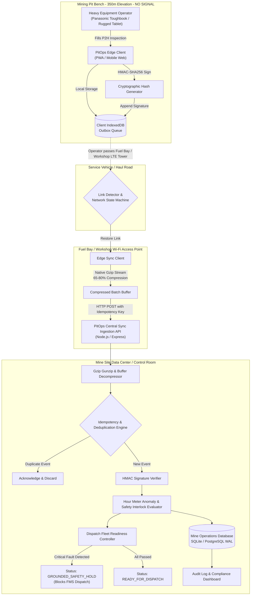

# PitOps Edge: System Architecture & Technical Specifications

> **Platform:** Offline-First Heavy Equipment Pre-Start Safety Inspection (P2H) & Dispatch Edge Synchronization  
> **Target Environment:** Open-Pit & Underground Mining Operations (Batu Hijau, Grasberg, Sangatta, Tutupan)  
> **Regulatory Alignment:** Kepmen ESDM No. 1827 K/30/MEM/2018 (Pedoman Teknis Keselamatan Pertambangan)

---

## 1. Operational Problem in Remote Mines

In deep open-pit and block-caving underground mines:
1. **Network Blackspots:** Mine benches (situated 150m to 450m below surface) and underground decline tunnels frequently lack private LTE or Wi-Fi coverage due to rock face attenuation and topography.
2. **Safety Compliance Lags:** Heavy equipment operators must complete mandatory Pre-Start Checks (**P2H**) before operating 240-ton haul trucks or 360-ton hydraulic shovels. Paper-based checklists or web apps dependent on live HTTP requests result in operators working uninspected units or delay dispatch schedules.
3. **Severe Bandwidth Contention:** Mine site wireless networks (such as Rajant Kinetic Mesh or 900 MHz telemetry poles) are often shared with real-time Fleet Management Systems (FMS) and Autonomous Haulage (AHS). Raw telemetry uploads cause packet drops.
4. **Audit Falsification Risks:** Regulators and internal mine inspectors require immutable proof that safety checklists were completed prior to shift commencement, preventing retroactive log creation following a mining incident.

---

## 2. Architecture Diagram



---

## 3. Core Technical Pillars

### 3.1. Offline-First Resilience via Client IndexedDB
The browser edge client does not require an active server connection to function.
- Equipment catalogs (`fleet_cache`) and previous hour meters are synchronized when the device is at the central ready line.
- When working offline in the pit, submissions are immediately persisted to the `outbox` object store with status `PENDING`.
- Unsent inspections survive tablet reboots, browser crashes, or battery depletion.

### 3.2. Bandwidth Optimization via Native Gzip Compression
To protect low-bandwidth mining mesh networks, all batch inspections are compressed client-side using `CompressionStream('gzip')`:
- Reduces payload size from typical JSON (2–5 KB per inspection) down to 400–700 bytes.
- Typical batch compression ratio: **65% to 80% bandwidth reduction**.
- The server stream pipeline handles both gzipped binary buffers (`Content-Encoding: gzip`) and fallback uncompressed JSON.

### 3.3. Tamper-Evident Cryptographic Hash Chain (HMAC-SHA256)
Every inspection record computes an HMAC signature across a canonical string before leaving the client:
```text
canonical_string = id | unit_code | shift | inspector_id | hour_meter | client_timestamp
hmac_signature   = HMAC_SHA256(canonical_string, SECRET_KEY)
```
- If an inspector or third-party attempts to manipulate the hour meter or timestamps retroactively, the server flags an `HMAC_SIGNATURE_MISMATCH` audit alert.
- Fully aligns with Kepmen ESDM No. 1827 K/30/MEM/2018 regarding safety compliance verification.

### 3.4. Idempotency & Deduplication
Mining wireless connections frequently suffer from asymmetric packet loss (the server receives the payload, but the mobile device never receives the HTTP 200 ACK).
- The client assigns a globally unique UUID (`event_id`) to each inspection.
- The server checks against an `idempotency_keys` table within an atomic database transaction.
- If a retransmitted batch is received, duplicate records are acknowledged to free the client outbox without double-writing database rows.

### 3.5. Hour Meter Continuity & Safety Interlocks
- **Hour Meter Anomaly Detection:** Compares submitted SMU with prior readings:
  - `new_hour < last_hour`: Flags `HOUR_METER_ROLLBACK`.
  - `new_hour - last_hour > 24`: Flags `HOUR_METER_UNREALISTIC_JUMP`.
- **Safety Interlock System:** If any of the 6 critical safety items fail (Service Brake, Steering, Emergency Stop, Fire Suppression, Seatbelt, Fatigue Sensor), the equipment is locked to `GROUNDED_SAFETY_HOLD`, notifying the dispatch dispatcher and workshop planner.

---

## 4. Purdue Model (ISA-95) OT/IT Convergence
PitOps Edge operates at **Level 2 / Level 3** of the Industrial Automation & Control Systems (IACS) hierarchy:
- **Level 1 (Field Devices):** CAN-bus J1939 sensors, brake pressure transducers, hour meter gauge.
- **Level 2 (Edge Control):** Rugged operator tablet running PitOps Edge Client.
- **Level 3 (Operations Management):** Central PitOps Dispatch Sync Server, Fleet Management System (FMS), Workshop CMMS.
- **Level 4 (Enterprise IT):** SAP S/4HANA Plant Maintenance, Corporate ESG/Safety Portal.
