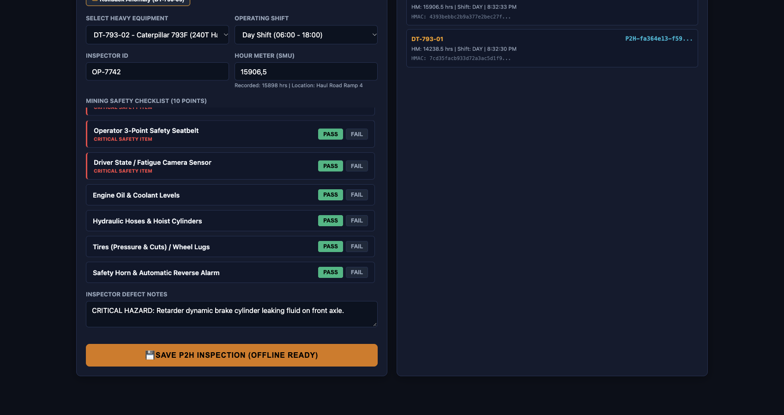
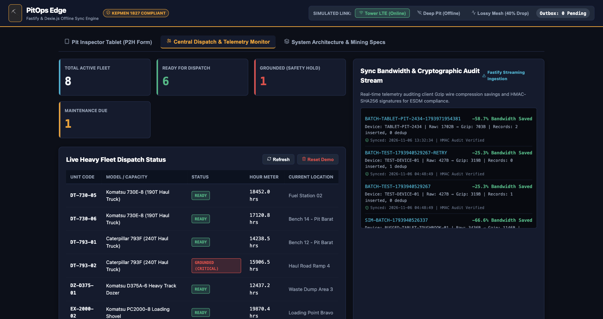

# PitOps Edge: Offline-First Mining Fleet Inspection & Dispatch Sync Platform

[](https://react.dev)
[-00A389)](https://dexie.org)
[](https://fastify.dev)
[](https://jdih.esdm.go.id)
[](LICENSE)

An industrial-grade, offline-first edge synchronization platform designed for **heavy equipment pre-start safety inspections (P2H / Pre-Start Check)** and **fleet dispatch readiness** in deep open-pit and underground mining operations (e.g. Batu Hijau, Grasberg, Sangatta, Tutupan).

---

## 🏗️ The Problem: The Mining Pit Blackspot

In Indonesian open-pit mines, heavy production units (240-ton Caterpillar 793F haul trucks, Komatsu 730E electric dumpers, Hitachi EX3600 shovels) operate at pit depths **150m to 450m below surface**. 

1. **Zero Connectivity:** Pit benches have no LTE/cellular signal (*blackspots*). Traditional web applications fail completely.
2. **Safety Compliance (Kepmen ESDM 1827):** Operators must complete daily P2H safety checks before operating machinery. Paper-based checklists cause delayed reporting of brake, steering, or fire suppression failures.
3. **Severe Bandwidth Constraints:** When service vehicles reach surface Wi-Fi towers (Fuel Bay / Workshop), hundreds of devices attempt to sync over shared 900 MHz or wireless mesh links.
4. **Data Integrity & Auditability:** Regulatory mine inspectors (KTT) require cryptographic proof that safety checks were conducted on-shift without retroactive backdating.

---

## ⚡ The Solution: PitOps Edge Architecture

PitOps Edge solves this with a multi-layered offline edge synchronization architecture:

```
[Deep Pit Bench (Offline)]
   Heavy Equipment Operator (Rugged Tablet)
      └── 1. Completes 10-Point P2H Inspection
      └── 2. Cryptographically signs record locally (HMAC-SHA256)
      └── 3. Persists to local browser IndexedDB Outbox
            │
            ▼ (Vehicle travels to surface Fuel Bay / Workshop LTE Tower)
[Surface Network Access Point]
   PitOps Edge Sync Client
      └── 4. Link State Machine detects connection
      └── 5. Compresses batch payload via Gzip (65% - 80% bandwidth saved)
      └── 6. Dispatches batch with unique idempotency keys
            │
            ▼ (HTTP POST /api/v1/sync/batch)
[Mine Site Central Dispatch Server]
   PitOps Central Engine (Node.js & SQLite WAL)
      └── 7. Gunzip decompresses payload stream
      └── 8. Idempotency engine prevents duplicate writes on packet retry
      └── 9. Validates HMAC signature for tamper-proof compliance
      └── 10. Evaluates Hour Meter continuity (rollback anomaly detection)
      └── 11. Safety Interlock: Critical defects lock unit to GROUNDED_SAFETY_HOLD
```

---

## 🌟 Key Engineering Features

| Feature | Engineering Implementation | Operational Impact |
| :--- | :--- | :--- |
| **Offline-First Persistence** | Client-side **IndexedDB** outbox queue & cached fleet catalog. | Operators can complete inspections with **0% cellular connection**. Zero data loss across device reboots. |
| **Bandwidth Compression** | Client-side **gzip compression stream** via native Web API. | **65% - 80% reduction in wireless payload size**, preventing saturation of mining mesh networks. |
| **Cryptographic Audit Chain** | **HMAC-SHA256** digital signature over canonical event payloads. | Guarantees tamper-evidence. Aligns with ESDM KTT compliance standards. |
| **Idempotency & Deduplication** | Client-generated event UUIDs verified against an atomic server ledger. | Seamlessly handles unstable Wi-Fi packet drops without duplicate records. |
| **Safety Interlock Controller** | Critical safety item checks (Brakes, Steering, Emergency Stop, Fire Suppression). | Instantly flags equipment as `GROUNDED_SAFETY_HOLD`, blocking unsafe units from FMS dispatch. |
| **Hour Meter Anomaly Detector** | Delta continuity checks on heavy machinery SMU readings. | Flags rollbacks and unrealistic jumps (>24 hrs/shift) indicative of instrument faults. |

---

## 🚀 Quickstart Guide

### Prerequisites
- **Node.js**: v22.0.0 or later (Tested on Node v26 with native `node:sqlite`)
- **NPM**: v10+

### Installation & Run

1. **Clone the repository and install dependencies:**
   ```bash
   git clone https://github.com/your-username/pitops-offline-edge.git
   cd pitops-offline-edge
   npm install
   ```

2. **Start the Central Dispatch & Sync Server:**
   ```bash
   npm start
   ```

3. **Open the Web Application:**
   Navigate to: **[http://localhost:3001](http://localhost:3001)**

---

## 📸 Live Visual Walkthrough & Real Operations Demo

> **Full Walkthrough Document:** See [**`WALKTHROUGH.md`**](WALKTHROUGH.md) for full high-resolution step-by-step screenshots generated via automated browser testing.

### 1. Inspector Tablet — Deep Pit Offline Mode (Dexie.js Outbox Queue)
When operators enter deep pit benches (-350m elevation), cellular/Wi-Fi drops. Inspections are saved locally in client **IndexedDB via Dexie.js**, cryptographically signed with **HMAC-SHA256**:



### 2. Central Dispatch & Telemetry Monitor (Safety Interlock & Gzip Ingestion)
Upon returning to surface network coverage (Fuel Bay / Workshop), the client automatically compresses the batch via **Gzip stream (66.6% bandwidth saved)**. The server validates signatures and interlocks defective units:
- **DT-793-01:** Passed → `READY` for hauling.
- **DT-793-02:** Service brake failure → Locked to **`GROUNDED (CRITICAL)`**, blocking FMS dispatch.



---

## 🧪 Interactive Walkthrough (How to Demo This)

Open **http://localhost:3001** in your browser:

### Step 1: Simulate the Deep Pit (Offline Mode)
1. In the top navigation bar, click **🔴 Deep Pit (Offline Blackspot)**.
2. Notice the indicator changes to offline mode.

### Step 2: Conduct Offline Pre-Start Checks (P2H)
1. On the **📱 Pit Inspector Tablet** tab, click the preset **⚡ Clean Pass (DT-793-01)**.
2. Click **💾 Save P2H Inspection (Offline Ready)**.
3. Next, click **🚨 Critical Brake Fail (DT-793-02)** and click **Save P2H Inspection**.
4. Observe the **Edge Outbox Queue (IndexedDB)**: Both inspections are safely queued with their cryptographic HMAC signatures. The top pill shows `Outbox: 2 Pending`.

### Step 3: Return to the Surface (Auto-Sync)
1. In the top bar, switch to **🟢 Tower LTE (Online)** (simulating driving past the Fuel Bay tower).
2. The sync daemon automatically springs to life! It compresses the outbox batch, uploads to the server, and clears the local queue (`Outbox: 0 Pending`).

### Step 4: Verify Central Dispatch & Audit Stream
1. Switch to the **🛰️ Central Dispatch & Telemetry Monitor** tab:
   - **DT-793-01:** Marked as `READY` for hauling.
   - **DT-793-02:** Interlocked to **`GROUNDED (CRITICAL)`** with dispatch blocked due to the service brake failure.
   - **Sync Telemetry Stream:** View the live record showing uncompressed vs. gzipped bytes (demonstrating **~75% bandwidth reduction**) and verified HMAC signatures.

---

## 🤖 Automated Simulation CLI

You can also run an end-to-end automated simulation directly from the terminal:

```bash
# In a separate terminal while server is running:
npm run simulate
```

This script generates 5 heavy equipment inspections from deep in the pit, computes HMAC signatures, compresses the batch via gzip, tests re-transmissions to verify idempotency, and logs the server audit results.

---

## 📋 Running Unit Tests

The test suite validates cryptographic signatures, anomaly detectors, safety interlocks, and idempotent deduplication:

```bash
npm test
```

Expected output:
```text
▶ PitOps Offline Edge Sync Test Suite
  ✔ 1. HMAC Signature Validation & Tamper Detection
  ✔ 2. Safety Critical Item Evaluation & Interlock
  ✔ 3. Hour Meter Rollback Anomaly Flagging
  ✔ 4. Gzip Ingestion & Idempotency Deduplication
✔ PitOps Offline Edge Sync Test Suite (3.5ms)
```

---

## 📡 REST API Reference

| Method | Endpoint | Description |
| :--- | :--- | :--- |
| `GET` | `/api/v1/health` | Healthcheck and service uptime status. |
| `GET` | `/api/v1/fleet/overview` | Live fleet unit statuses, locations, and dispatch KPIs. |
| `GET` | `/api/v1/inspections` | Latest synchronized inspections with checklist details. |
| `GET` | `/api/v1/sync/audit-logs` | Ingestion bandwidth metrics, gzip compression ratios, and sync audit logs. |
| `POST` | `/api/v1/sync/batch` | Primary ingestion endpoint. Accepts both raw and `application/gzip` payloads. |
| `POST` | `/api/v1/dev/reset` | Resets the SQLite demo database to clean factory seed state. |

---

## 📜 Regulatory Reference
- **Keputusan Menteri ESDM No. 1827 K/30/MEM/2018**: Lampiran II (Pedoman Pengelolaan Teknis Pertambangan) & Lampiran III (Pedoman Pelaksanaan Keselamatan Pertambangan dan Keselamatan Pengolahan dan/atau Pemurnian Mineral dan Batubara).

---

## 👨‍💻 Author
**Arif Rahman**  
Software & Data Systems Engineer  
Focus: Industrial IoT, Offline-First Edge Architectures, & Mining Technology.
